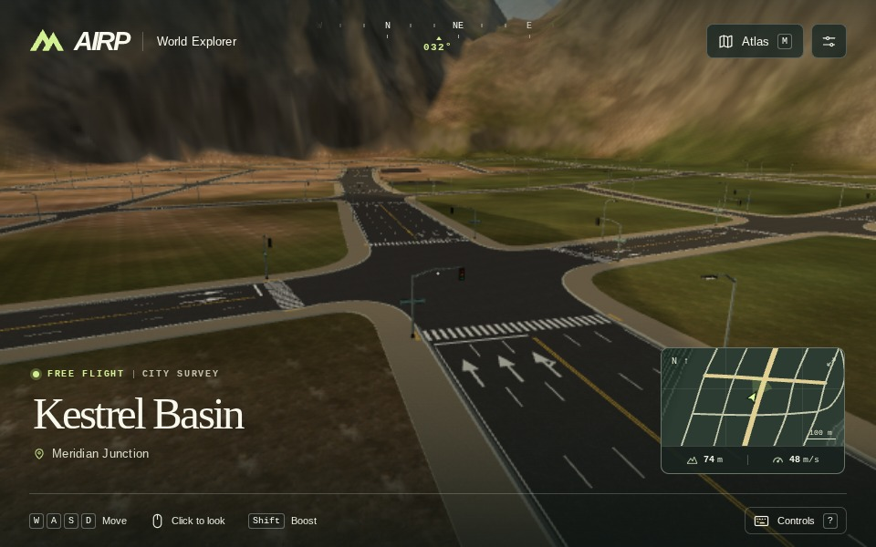

# AIRP · World Explorer

**Kestrel Basin** is a 4.19 km² browser-playable district. Phase 2 opens above Meridian Junction. Press **G** to walk the streets, or **M** to inspect the city plan and jump to Orchard Circle, Juniper Heights or a district-wide aerial view.



[Ground-level boulevard](docs/basin-boulevard.jpg) · [Orchard Circle](docs/orchard-circle.jpg) · [City atlas and parcels](docs/city-atlas.jpg)

## Run locally

Use Node.js 22.12+ and a desktop browser with WebGL2 enabled.

```sh
npm ci
npm run dev
```

Open the local URL printed by Vite. To serve the production build locally, run `npm run build` and then `npm run preview`. Static hosting can serve the contents of `dist/` over HTTP or HTTPS. Vite uses relative asset paths for subdirectory deployments. All terrain maps, libraries and the generation worker ship with the build.

## Inspection controls

| Action | Input |
| --- | --- |
| Fly forward, backward or sideways | W, A, S, D |
| Look | Click the scene, then move the mouse. Arrow keys also rotate the camera. Drag on a touch screen. |
| Climb / descend | Space / C or Ctrl |
| Boost / change base speed | Shift / mouse wheel |
| Switch flight and eye-level inspection | G or Explorer settings |
| Open the city atlas | M or the minimap. Drag to pan, scroll to zoom, click to relocate. Named survey stations are available below the map. |
| Inspect frame time, coordinates and residency | F3 or Explorer settings |
| Inspect streets and building plots | Open the atlas, expand Planning overlays, and choose centerlines, boundaries, junctions, zoning, parcels, connectivity or grading limits. Selections also appear in 3D. |
| Show chunk borders | Explorer settings → Chunk boundaries |
| Release the mouse / dismiss a panel | Esc |

The compass and both maps use north as negative Z. Altitude is elevation above the world datum in metres. The speed readout shows the configured travel rate before boost.

## World and rendering

The playable district measures **2,048 × 2,048 m (4.19 km²)**. The intended map envelope is **9,728 × 9,728 m (94.63 km²)**. The camera is constrained to the current district. Scenic terrain continues outside it so the edge stays out of view. The streaming budget depends on the graphics preset and camera position.

| System | Implementation |
| --- | --- |
| Engine | Three.js WebGL2, Vite, ACES tone mapping, hemisphere light, directional sunlight and a camera-relative sky. Near-field shadows update when their coverage or geometry changes. |
| Terrain | A seeded world-space height field combines authored ridges, gullies and an alluvial terrace. Three locally hosted, scanned ground materials blend by slope and terrain variation. Colour, tangent-normal and roughness detail share world-space coordinates. |
| Streaming | Two module workers prepare transferable typed arrays. Each coarse sector covers 4 × 4 chunks. A coarse patch stays visible until its detailed mesh arrives. A single main-thread update swaps coverage. The renderer limits geometry activations per frame, drops stale work and disposes evicted geometry. |
| Seam handling | Chunks measure 256 m. The 8-, 16- and 32-subdivision meshes share a 32 m boundary profile. A triangulated transition ring connects each interior to that profile. Adjacent chunks sample the same world-space heights and normals. |
| Inspection | Pointer-lock flight, keyboard look, terrain-following ground mode at 1.72 m, contour atlas and minimap. The atlas is generated from the same elevation field as the 3D mesh. |
| Assets | A manifest and reference-counted cache share textures and glTF resources. Loads are deduplicated, failed entries can be retried, and the last handle releases shared GPU resources. |

| Preset | Detailed chunk window | Coarse sectors | Shadow map | Maximum DPR |
| --- | ---: | ---: | ---: | ---: |
| Low | 5 × 5 | 5 × 5 | Off | 1.0 |
| Medium | 7 × 7 | 5 × 5 | 1,024² | 1.4 |
| High | 9 × 9 | 7 × 7 | 2,048² | 1.75 |

Adaptive resolution can lower the render scale under sustained load. The HUD stays at display resolution. Coarse-sector indices under active detail tiles are masked. GPU triangle submission counters include these degenerate triangles. Browser GPU resource counts are available in the overlay.

## Integration points

- `src/data/world.js` defines the seed, metre scale, playable bounds, target envelope, stable identifiers, stations and quality budgets.
- `src/terrain/field.js` owns the underlying terrain shape. The road grading field feeds mesh generation and collision queries. Future building pads should use the same interface.
- `src/world/queries.js` exposes `groundHeight(x, z)` and `surfaceAt(x, z)` without importing the renderer. Ground height interpolates the actual triangles of the canonical near mesh. The inspector passes the resident resolution to follow the visible surface during streaming. Surface metadata includes district, persistent tile ID, normal and slope.
- `src/world/streamer.js` owns residency. Future environment layers can key placements, collisions and navigation links by signed tile coordinates. Keep placed-object IDs independent of mesh lifetime and LOD.
- `src/data/assets.js` and `src/core/assets.js` handle assets separately from placements. Register glTF assets with local URLs, source/license and import scale/orientation. Keep each acquired handle until all its instances have left the scene. Add dimensions, collision proxies and entrance data when adding buildings.
- `src/debug/` contains the temporary camera, map and inspection UI. A future character controller can provide the camera position to the streamer and use the world queries independently.

## Verification

```sh
npm test
npx playwright-core install chromium
npm run test:browser
```

The browser check builds the production app, starts isolated local servers, opens real WebGL2 contexts and exercises both the production entry point and development instrumentation. To use an existing Chromium executable, set `CHROME_PATH`. For a headless software-rendering environment, set `AIRP_SOFTWARE_GL=1`. Screenshots are written to `test-results/`.

The numerical suite checks shared heights and normals in both directions at every LOD pairing, manifold topology, full chunk area, ground-to-mesh agreement, deterministic reloads, a gentle planning terrace, bounded residency, stale work, disposal and asset reference counts.

### Recorded Phase 1 run

| Check | Result |
| --- | --- |
| Automated numerical and lifecycle tests | 8 passed |
| Production and development browser checks | Passed in headless Chromium 143 with WebGL2. Pointer-lock flight, boosted flight across three chunk boundaries, ground following, atlas travel and all three presets were exercised. |
| Streaming soak | Two circuits from the overlook through three district corners and preset changes produced 500 mesh activations and 524 evictions after the initial medium window was populated. On both warmed returns, the same view held 49 detail chunks, 25 coarse sectors, 48 uploaded geometries and 8 GPU textures. |
| Visual inspection | Aerial, ground-level and boundary-overlay views were checked. The automated screenshot check also detects a cleared drawing buffer during resolution changes. |
| Medium overlook workload | 32 main-pass draw calls and 42,480 submitted triangles. An isolated 40-frame sample averaged 149 ms/frame (6.7 FPS) in CPU-based SwiftShader at a 960 × 600 viewport and a 624 × 390 adaptive render buffer. |

The hardware target is 60 FPS at 1080p Medium on a desktop with a GTX 1650-class GPU and 16 GB RAM. A hardware-backed benchmark is still pending. The software-renderer result establishes rendering correctness and a reproducible workload.

## Terrain assets

The committed WebP files are ready for use. To rebuild them, install Python 3 and Pillow and run `python scripts/prepare-terrain.py`. The script fetches 1K source maps and stores local colour textures and packed normal-XY / roughness textures. Source attribution is in [ASSETS.md](ASSETS.md).

## Streets, zoning and Phase 3 placement

The master plan routes development along the alluvial terrace and southern pass. The steep outer ridges remain greenbelt. The network has **92 road segments** and **9.76 km of centerline within the playable boundary**. The South Pass Highway extends a further 225 m beyond the southern edge for visual continuity. Drivers keep left. The 61 graph nodes include crossroads, T-junctions, bends and the external highway gateway.

The road cross-sections range from 2.75 m residential lanes to 3.6 m highway lanes. Basin Boulevard has six lanes, Meridian Avenue has four, and Juniper Heights winds around the western bench. Orchard Circle has a clockwise circulating lane, raised island, mountable apron and approach refuges. Footways, curb ramps, gutter channels, drain grates, arrows, crossings, signs, signals and parking bays share the road geometry batches.

| Allocation | Phase 3 building sites |
| --- | ---: |
| Exchange Quarter, downtown | 22 |
| Linden Ward, residential | 95 |
| Juniper Heights, luxury residential | 20 |
| Market District, commercial | 29 |
| Civic Gardens, public facilities | 3 |
| Foundry Ward, industrial | 14 |
| **Total** | **183** |

Four additional parcels are in use as parking courts. Orchard Park, Orchard Playfield and Park Crescent Greenway are protected reservations. The civic sites reserve a hospital, a school and a civic hall.

### Geometry, grading and streaming

- `src/roads/layout.js` contains the authored street chains, shared junction nodes and cross-sections. `network.js` samples cubic curves, computes station distances and defines the engineered street elevations.
- The original elevation field remains available as `naturalElevation(x,z)`. Grading takes effect around road corridors and blends back to native topography. The graded bench accounts for the widest terrain LOD stencil. Plane changes occur on tile boundaries so the near, medium and far meshes all support the same road elevation.
- `junctions.js` gives adjacent roads shared mouth sections and rounded curb returns. `build.js` generates pavement, roadside detail, parking and markings. `mesh-writer.js` clips the primitives to the terrain's 256 m tiles before centimetre quantization.
- Vite compiles the plan into compressed, same-origin tile files. The browser streams base surfaces farther than small details, uses a shared road material, caps concurrent requests and keeps a bounded 12 MiB decoded-data cache. Unloaded render geometry is disposed. `RoadLayer.surfaceHeight` resolves the actual road, curb, island or sidewalk triangles for eye-level exploration.
- The intended 94.63 km² envelope remains available for additional authored districts. The current plan and performance measurements cover Kestrel Basin.

### Placement and navigation data

A build exports `city/parcels.json` with metre units, stable IDs, zoning, program, elevations, corners, road frontage, entrance, yaw, setbacks, height limits and maximum footprint. The runtime also exports the same records from `src/roads/parcels.js`. Only records with `use === 'building'` are building sites. The buildable polygon is `envelope`. Yaw is in radians for a model whose front faces local +Z.

For Phase 3, select a model appropriate to the parcel's program, verify its rotated footprint is inside the envelope and align its entrance with the frontage. The parcel elevation is the reference for foundation placement. Validate the imported model's entrance, footprint and collision proxy after placement.

`src/roads/navigation.js` exports 232 directed lane centerlines, 176 sidewalk paths, 146 crossings, vehicle and pedestrian graphs and a shortest-path function. Graph edges carry geometry, lengths and traversal types. Each site has a pedestrian destination named `parcel.id + '/entrance'`. Each parking court also has a vehicle destination named `parcel.id + '/parking'`. The highway gateway represents continuation into a future district.

### Phase 2 verification

The 15 automated tests include the original eight terrain, streaming and asset checks. They cover network connectivity, gradients, junction caps, frontage and zoning, walk and drive access, terrain agreement at all three LODs, deterministic mesh compilation and matching asphalt boundaries across tiles. The steepest sampled road centerline is **6.94%**.

The production browser test visits the boulevard, rotary, hillside route and overview, exercises all seven overlays, and repeats the Phase 1 travel and resource checks with the road layer active. Screenshot captures are saved by `npm run test:browser`. Hardware-accelerated frame rate and foundation fit for actual building models remain to be measured.

At Meridian Junction the Medium preset submitted 37 main-pass draw calls and 86,057 triangles. The software-rendered Chromium run held 49 detail terrain chunks, 25 horizon sectors and 28 road batches at this station. This workload is a baseline for comparing future Phase 3 asset imports.
