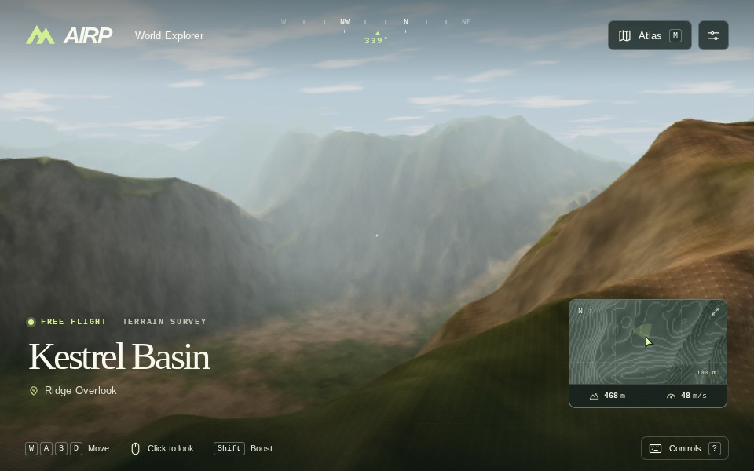

# AIRP · World Explorer

Phase 1 of AIRP is a browser-playable terrain district called **Kestrel Basin**. Start at Ridge Overlook, fly down to the alluvial terrace, or open the atlas to visit the North Divide.



## Run locally

Use Node.js 22.12+ and a desktop browser with WebGL2 enabled.

```sh
npm ci
npm run dev
```

Open the local URL printed by Vite. To serve the production build locally, run `npm run build` and then `npm run preview`. Static hosting can serve the contents of `dist/` over HTTP or HTTPS. Vite uses relative asset paths for subdirectory deployments. All terrain maps, libraries and the generation worker ship with the build.

## Inspection controls

| Action | Input |
| --- | --- |
| Fly forward, backward or sideways | W, A, S, D |
| Look | Click the scene, then move the mouse. Arrow keys also rotate the camera. Drag on a touch screen. |
| Climb / descend | Space / C or Ctrl |
| Boost / change base speed | Shift / mouse wheel |
| Switch flight and eye-level inspection | G or Explorer settings |
| Open the terrain atlas | M or the minimap. Drag to pan, scroll to zoom, click to relocate. Named survey stations are available below the map. |
| Inspect frame time, coordinates and residency | F3 or Explorer settings |
| Show chunk borders | Explorer settings → Chunk boundaries |
| Release the mouse / dismiss a panel | Esc |

The compass and both maps use north as negative Z. Altitude is elevation above the world datum in metres. The speed readout shows the configured travel rate before boost.

## World and rendering

The playable district measures **2,048 × 2,048 m (4.19 km²)**. The intended map envelope is **9,728 × 9,728 m (94.63 km²)**. The camera is constrained to the current district. Scenic terrain continues outside it so the edge stays out of view. The streaming budget depends on the graphics preset and camera position.

| System | Implementation |
| --- | --- |
| Engine | Three.js WebGL2, Vite, ACES tone mapping, hemisphere light, directional sunlight and a camera-relative sky. Near-field shadows update when their coverage or geometry changes. |
| Terrain | A seeded world-space height field combines authored ridges, gullies and an alluvial terrace. Three locally hosted, scanned ground materials blend by slope and terrain variation. Colour, tangent-normal and roughness detail share world-space coordinates. |
| Streaming | Two module workers prepare transferable typed arrays. Each coarse sector covers 4 × 4 chunks. A coarse patch stays visible until its detailed mesh arrives. A single main-thread update swaps coverage. The renderer limits geometry activations per frame, drops stale work and disposes evicted geometry. |
| Seam handling | Chunks measure 256 m. The 8-, 16- and 32-subdivision meshes share a 32 m boundary profile. A triangulated transition ring connects each interior to that profile. Adjacent chunks sample the same world-space heights and normals. |
| Inspection | Pointer-lock flight, keyboard look, terrain-following ground mode at 1.72 m, contour atlas and minimap. The atlas is generated from the same elevation field as the 3D mesh. |
| Assets | A manifest and reference-counted cache share textures and glTF resources. Loads are deduplicated, failed entries can be retried, and the last handle releases shared GPU resources. |

| Preset | Detailed chunk window | Coarse sectors | Shadow map | Maximum DPR |
| --- | ---: | ---: | ---: | ---: |
| Low | 5 × 5 | 5 × 5 | Off | 1.0 |
| Medium | 7 × 7 | 5 × 5 | 1,024² | 1.4 |
| High | 9 × 9 | 7 × 7 | 2,048² | 1.75 |

Adaptive resolution can lower the render scale under sustained load. The HUD stays at display resolution. Coarse-sector indices under active detail tiles are masked. GPU triangle submission counters include these degenerate triangles. Browser GPU resource counts are available in the overlay.

## Integration points

- `src/data/world.js` defines the seed, metre scale, playable bounds, target envelope, stable identifiers, stations and quality budgets.
- `src/terrain/field.js` owns the underlying terrain shape. Future graded corridors and pads should feed this same field before mesh generation and collision sampling.
- `src/world/queries.js` exposes `groundHeight(x, z)` and `surfaceAt(x, z)` without importing the renderer. Ground height interpolates the actual triangles of the canonical near mesh. The inspector passes the resident resolution to follow the visible surface during streaming. Surface metadata includes district, persistent tile ID, normal and slope.
- `src/world/streamer.js` owns residency. Future environment layers can key placements, collisions and navigation links by signed tile coordinates. Keep placed-object IDs independent of mesh lifetime and LOD.
- `src/data/assets.js` and `src/core/assets.js` handle assets separately from placements. Register glTF assets with local URLs, source/license and import scale/orientation. Keep each acquired handle until all its instances have left the scene. Add dimensions, collision proxies and entrance data when adding buildings.
- `src/debug/` contains the temporary camera, map and inspection UI. A future character controller can provide the camera position to the streamer and use the world queries independently.

## Verification

```sh
npm test
npx playwright-core install chromium
npm run test:browser
```

The browser check builds the production app, starts isolated local servers, opens real WebGL2 contexts and exercises both the production entry point and development instrumentation. To use an existing Chromium executable, set `CHROME_PATH`. For a headless software-rendering environment, set `AIRP_SOFTWARE_GL=1`. Screenshots are written to `test-results/`.

The numerical suite checks shared heights and normals in both directions at every LOD pairing, manifold topology, full chunk area, ground-to-mesh agreement, deterministic reloads, a gentle planning terrace, bounded residency, stale work, disposal and asset reference counts.

### Recorded Phase 1 run

| Check | Result |
| --- | --- |
| Automated numerical and lifecycle tests | 8 passed |
| Production and development browser checks | Passed in headless Chromium 143 with WebGL2. Pointer-lock flight, boosted flight across three chunk boundaries, ground following, atlas travel and all three presets were exercised. |
| Streaming soak | Two circuits from the overlook through three district corners and preset changes produced 500 mesh activations and 524 evictions after the initial medium window was populated. On both warmed returns, the same view held 49 detail chunks, 25 coarse sectors, 48 uploaded geometries and 8 GPU textures. |
| Visual inspection | Aerial, ground-level and boundary-overlay views were checked. The automated screenshot check also detects a cleared drawing buffer during resolution changes. |
| Medium overlook workload | 32 main-pass draw calls and 42,480 submitted triangles. An isolated 40-frame sample averaged 149 ms/frame (6.7 FPS) in CPU-based SwiftShader at a 960 × 600 viewport and a 624 × 390 adaptive render buffer. |

The hardware target is 60 FPS at 1080p Medium on a desktop with a GTX 1650-class GPU and 16 GB RAM. A hardware-backed benchmark is still pending. The software-renderer result establishes rendering correctness and a reproducible workload.

## Terrain assets

The committed WebP files are ready for use. To rebuild them, install Python 3 and Pillow and run `python scripts/prepare-terrain.py`. The script fetches 1K source maps and stores local colour textures and packed normal-XY / roughness textures. Source attribution is in [ASSETS.md](ASSETS.md).

## Phase 2

Lay out the master roads and zoning on the terrace. Add graded corridors, intersection and sidewalk geometry, a connectivity graph and frontage-aware parcel boundaries. Validate gradients, connectivity, clipping and parcel overlaps before adding architectural assets. Buildings, vegetation, advanced water, characters and NPCs are later phases.
