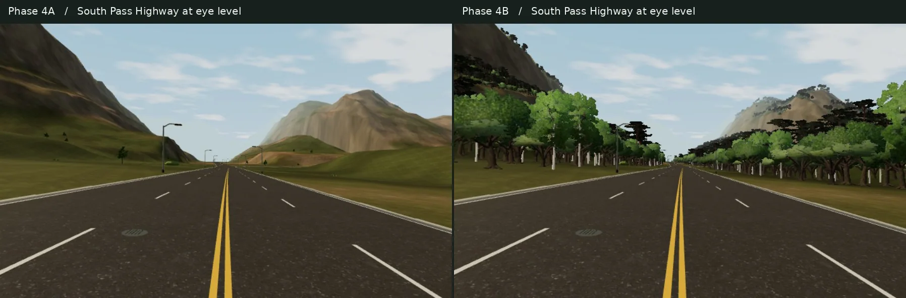
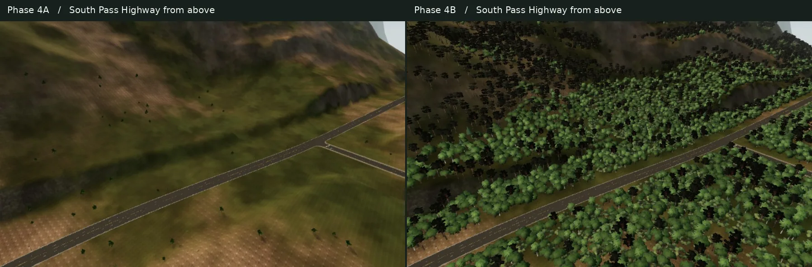
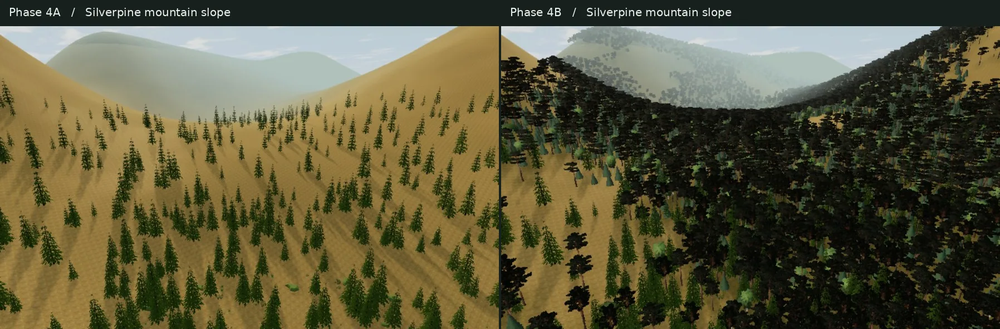
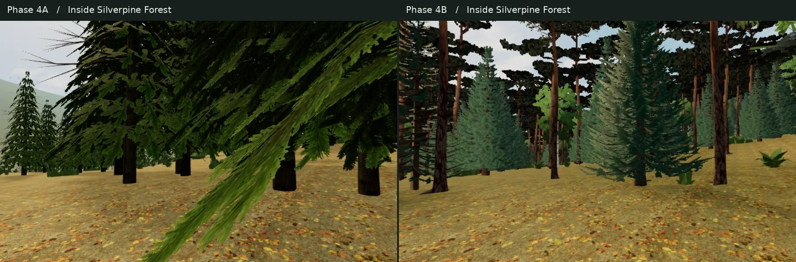
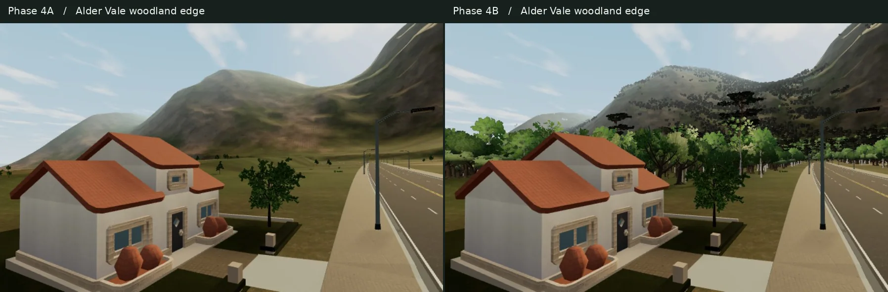
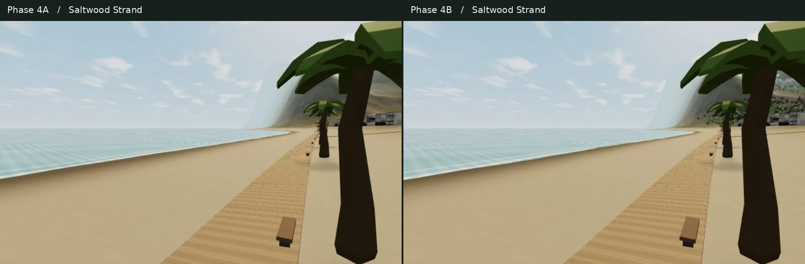
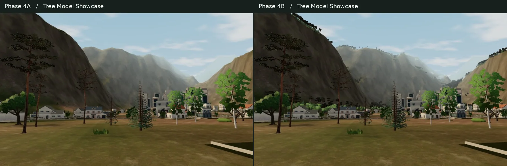

# Phase 4B forest review

Open **Silverpine Forest** in the atlas for a ground view. South Pass Highway passes the forested slopes around world coordinates **X −595 m, Z 1952 m**. Press **F3** to see the resident tree and tile counts, current mesh detail counts, frame time and rolling worker generation time.

[Open the Netlify review build](https://deploy-preview-3--airp1.netlify.app/) · [Pull request #3](https://github.com/Srijit23/airp/pull/3)

## Population

The deterministic census evaluated every 256 m tile in the 9,728 m square world. The area estimates sample the inland habitat classification on a 32 m grid. They include local clearings, developed land and unsuitable steep ground within each habitat. Density is averaged over this gross habitat area. The existing showcase and planted landscape props are counted separately from this census.

| Habitat | Inland km² | Forest trees | Trees per hectare | Oak | Scots pine | Spruce | Birch | Acacia |
|---|---:|---:|---:|---:|---:|---:|---:|---:|
| Warm dry lowland | 2.24 | 18,877 | 84.2 | 8,385 | 1,684 | 222 | 2,912 | 5,674 |
| Temperate valley | 4.10 | 23,945 | 58.5 | 11,750 | 6,463 | 432 | 5,300 | 0 |
| Upland | 17.03 | 207,214 | 121.6 | 8,958 | 145,321 | 38,152 | 14,783 | 0 |
| Cool montane | 56.32 | 597,770 | 106.1 | 6,807 | 286,295 | 282,122 | 22,546 | 0 |

## Rendering and streaming

World-seeded candidate positions span tile boundaries. Correlated habitat and clearing fields control acceptance and species weights. Crown-sized clearances use road corridors, junction radii, parcel and zoning polygons, park reservations, the coast, atlas landings and the original showcase clearing. Root heights are calculated against the terrain triangles at all three streaming resolutions. Only unplanned legacy wild tree props sharing occupied stand cells are suppressed.

A worker generates the camera window nearest-first with one tile in flight. Moving the window drops old buffers and ignores obsolete results. Instances share the approved GLB geometries and materials with the showcase through the existing asset manager. Close crowns use real geometry and shadows. Each distant tree selects one of 12 cropped, alpha-masked views baked from its species, including overhead views. A local forest-cover texture applies contact shade from measured stand occupancy. The five original GLBs and their source credits are in [the tree asset directory](../../public/assets/trees/).

| Preset | Near mesh cap | Mid mesh cap | Distant crown reach |
|---|---:|---:|---:|
| Low | 3 | 9 | 1,150 m |
| Medium | 6 | 18 | 1,650 m |
| High | 12 | 32 | 2,450 m |

The oak, spruce, birch and acacia portraits in `forest-views.webp` are AIRP renders of models by vinish.dev under CC BY 4.0. The Scots pine portraits derive from tevy’s CC0 model. AIRP rendered and cropped 12 views of each model and combined them into a WebP atlas. [Artist links, source titles and license URLs](../../public/assets/trees/CREDITS.txt)

## Matched Chromium captures

Both passes use the same camera coordinates, orientation, medium quality, 896 × 544 viewport, and fixed 0.8 rendering pixel ratio. The baseline is merged Phase 4A at `f2cd7c0`. Open a picture for the full-size comparison.

### South Pass Highway at eye level

### South Pass Highway from above

### Silverpine mountain slope

### Inside Silverpine Forest

### Alder Vale woodland edge

### Saltwood Strand

### Tree Model Showcase

## Frame and streaming measurements

These measurements come from headless Chromium using ANGLE SwiftShader software rendering. For each settled camera, the runner discards two warm-up intervals and records 12 animation-frame intervals. FPS is the reciprocal of the upper median interval. These short runs characterize this software renderer. Physical desktop and integrated GPU performance still needs measurement.

| View | Before FPS | After FPS | Before frame ms | After frame ms | After p90 ms | Draws before → after | Triangles before → after |
|---|---:|---:|---:|---:|---:|---:|---:|
| South Pass Highway at eye level | 2.82 | 1.66 | 355.2 | 602.7 | 1276.2 | 85 → 149 | 340,438 → 382,946 |
| South Pass Highway from above | 4.06 | 2.54 | 246.3 | 393.5 | 569.0 | 69 → 106 | 325,587 → 279,175 |
| Silverpine mountain slope | 1.22 | 0.89 | 817.7 | 1125.1 | 2167.4 | 37 → 88 | 993,970 → 1,075,828 |
| Inside Silverpine Forest | 0.73 | 0.96 | 1370.8 | 1038.3 | 2108.4 | 34 → 105 | 1,342,266 → 722,173 |
| Alder Vale woodland edge | 6.67 | 1.41 | 149.9 | 711.5 | 1500.4 | 84 → 146 | 339,887 → 457,637 |
| Saltwood Strand | 2.86 | 2.58 | 349.8 | 387.7 | 740.5 | 69 → 83 | 307,738 → 306,058 |
| Tree Model Showcase | 1.11 | 0.95 | 898.2 | 1057.7 | 1138.9 | 159 → 223 | 762,030 → 803,908 |

| View | Resident tiles | Resident trees | Instances in submitted tile batches | Near / mid | CPU placement data MiB | Mean worker ms per tile¹ |
|---|---:|---:|---:|---:|---:|---:|
| South Pass Highway at eye level | 193 | 98,457 | 28,242 | 3 / 18 | 3.00 | 1.2 |
| South Pass Highway from above | 186 | 88,191 | 23,736 | 0 / 0 | 2.69 | 1.4 |
| Silverpine mountain slope | 193 | 97,541 | 40,929 | 0 / 0 | 2.98 | 1.8 |
| Inside Silverpine Forest | 193 | 111,652 | 53,311 | 6 / 18 | 3.41 | 2.8 |
| Alder Vale woodland edge | 193 | 90,395 | 32,409 | 0 / 18 | 2.76 | 1.5 |
| Saltwood Strand | 119 | 42,106 | 5,656 | 0 / 0 | 1.28 | 1.6 |
| Tree Model Showcase | 193 | 98,447 | 20,939 | 0 / 0 | 3.00 | 2.6 |

¹ Rolling sample of the most recent 64 tile jobs. Submitted batch counts include individual trees clipped or obscured by terrain. Placement memory counts the packed CPU records. The renderer and GLB assets use additional memory. [Raw per-view measurements](metrics.json) include GPU geometry and texture counts.

## Reproduction

Use Node 22 or newer and run `npm ci`, `npm test` and `npm run build`. Install Chromium with `npx playwright-core install chromium`. Run `npm run test:forests`, `npm run test:trees` and `npm run test:browser`. Set `AIRP_SOFTWARE_GL=1` to use SwiftShader and `CHROME_PATH` to choose an existing Chromium executable. The seven-pose runner accepts `--baseline` when copied to the original checkout.

Run `node scripts/forest-census.js` for exact current counts. Add `--shade` after creating `test-results/` to write the cover map as an 8-bit PGM. Save it as `public/assets/trees/forest-cover.webp` with Pillow WebP quality 88. Run `node scripts/forest-impostors.js` to rebake the local portrait atlas and its crop rectangles.

## Visual limits

Sheer rock cuts, sandy coastal terrain and reserved clearings remain open. The mature Scots pine has an open crown, particularly on exposed ridges. Distant foliage uses baked daylight and discrete viewing angles. Some crown changes can be seen when orbiting trees or moving between crowded detail bands. The close inspection models use live lighting and shadows.
