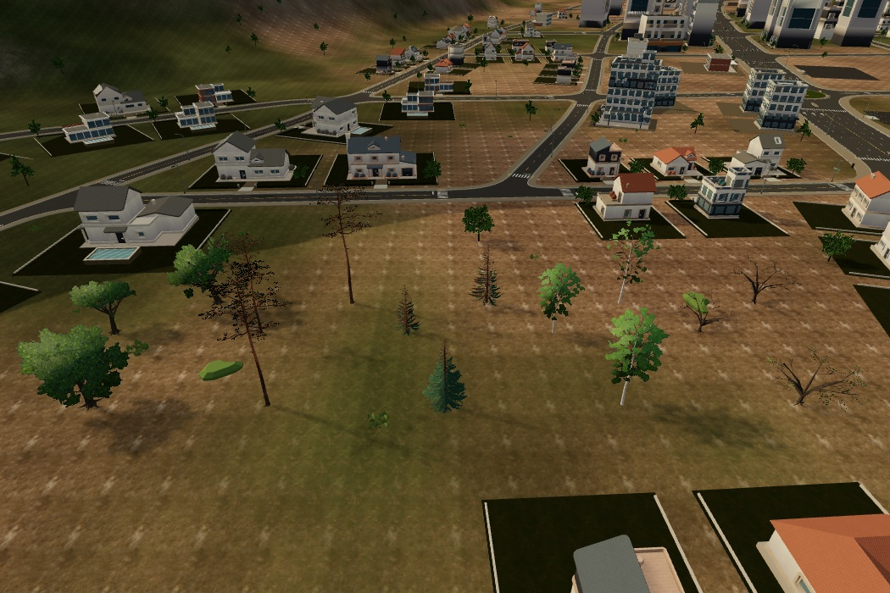
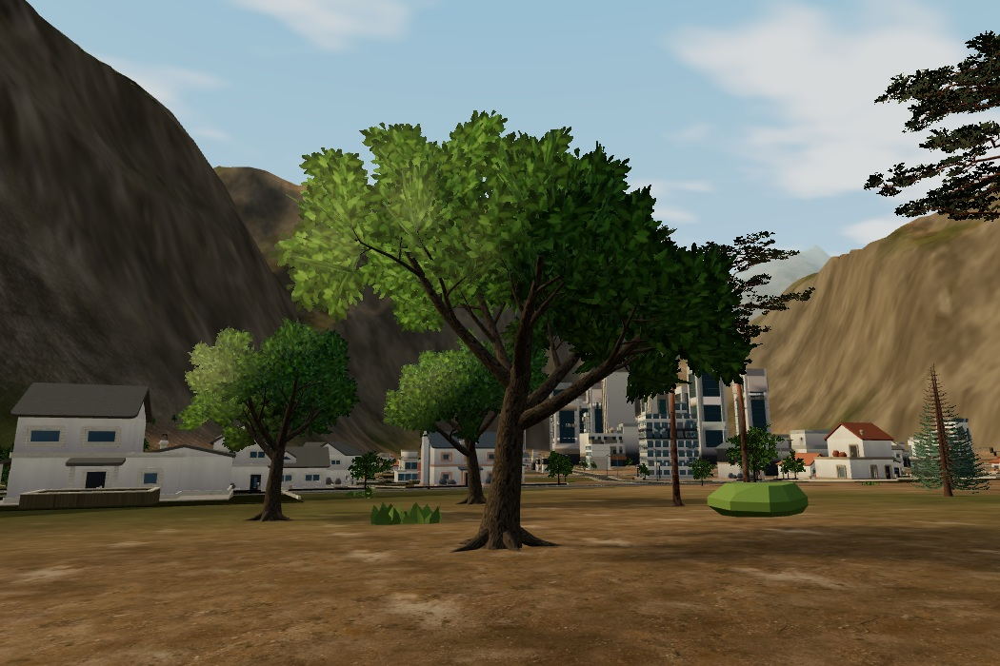
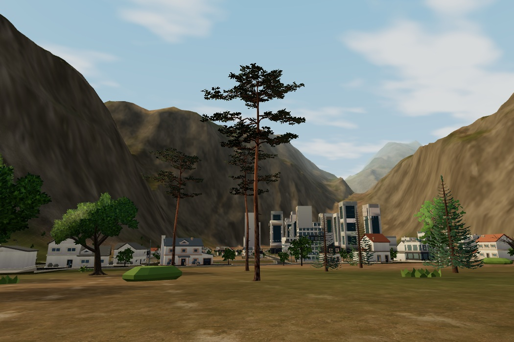
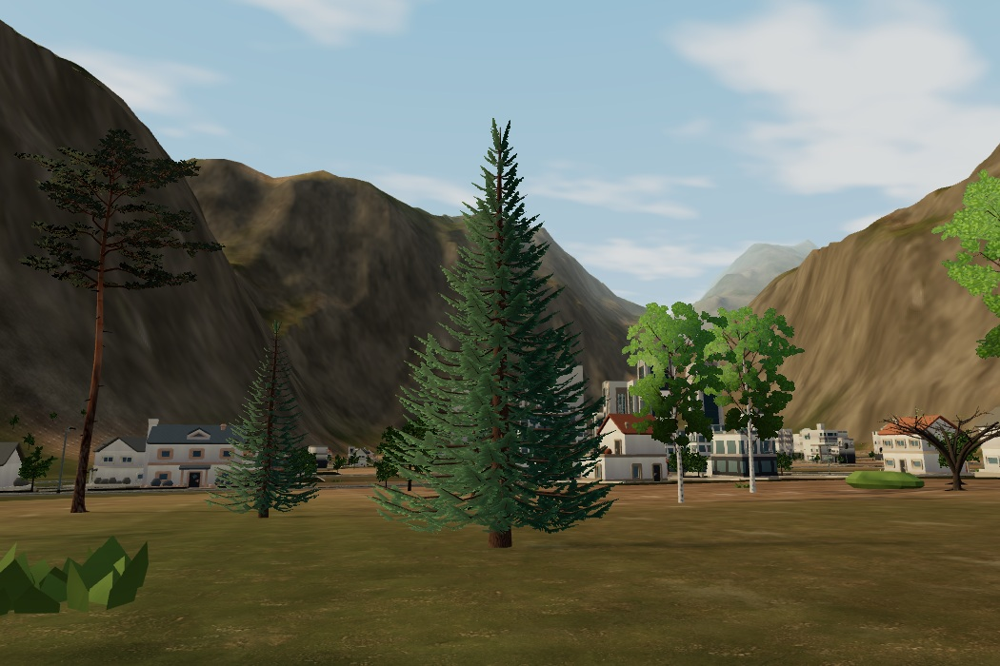
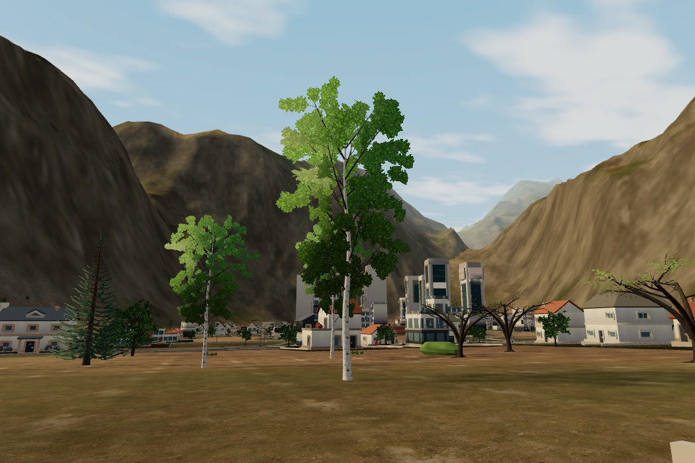
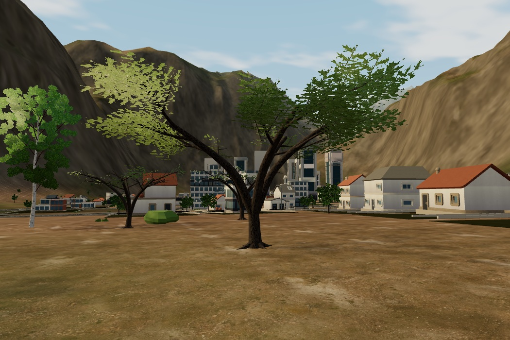
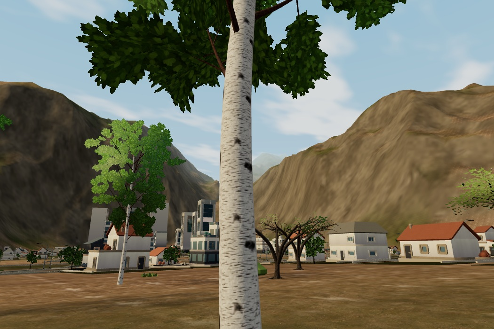

# Tree Model Showcase

Open the atlas with **M** and choose **Tree Model Showcase**. The arrival point is in the clearing above Juniper Heights, about 11 m beyond the road edge. Press **G** for the 1.72 m ground camera. [View the atlas arrival in the production build.](atlas-arrival.jpg) Each species has three specimens with different scales and rotations.

| Oak | Scots pine |
| --- | --- |
|  |  |
| **Spruce** | **Birch** |
|  |  |
| **Umbrella-thorn acacia** | **Birch bark detail** |
|  |  |

The images were captured in Chromium using AIRP's cameras, terrain and lighting. The five self-contained GLBs total 3.78 MiB. The renderer loads one shared asset per species on approach, switches each specimen between its two geometry levels and releases the resources on departure. [Artist credits and triangle counts](../../ASSETS.md#phase-4a-showcase-trees)
